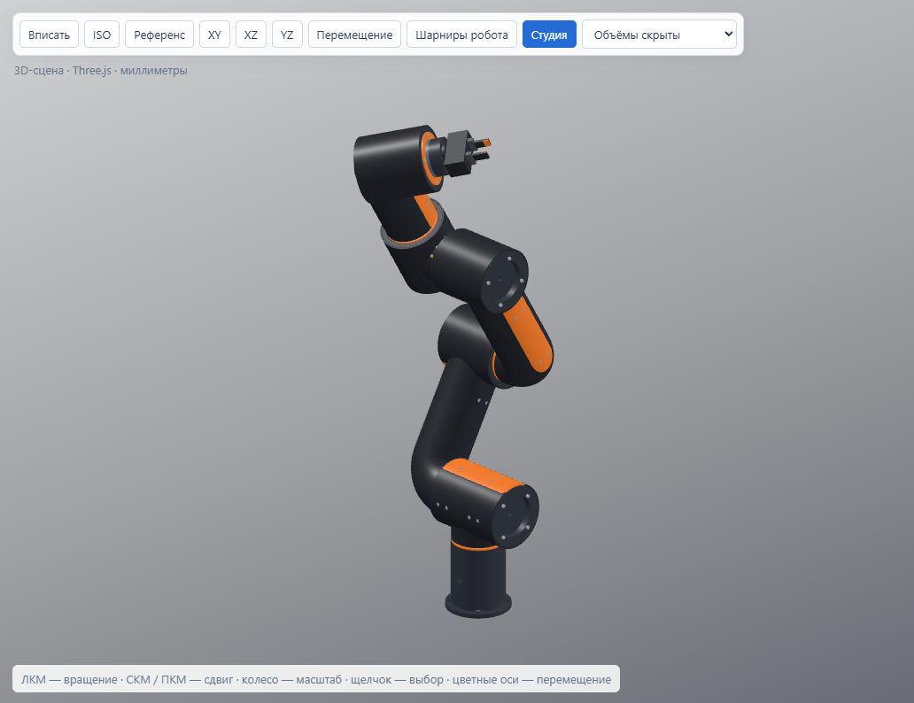

# GearLab 5.4

Бесплатная Windows-программа для параметрического CAD, передач и компоновки роботов.

## Скачать и запустить

Откройте [Releases](https://github.com/mikko2281/GearLab/releases/latest), скачайте **GearLab_5.4_Windows.zip** и распакуйте всю папку. Запустите `GearLab.exe` или `Robotics.cmd` для робототехники. Windows 10/11 x64, .NET Framework 4.8. Изолированное CAD-ядро включено; устанавливать Python не требуется. Three.js использует WebView2, также есть резервный WPF-просмотр.

## Робот по авторской модели

В «Проект → РОБОТ1 · NEMA 17 · 800 мм» находится готовая CAD-сборка по предоставленному `РОБОТ1.blend`: чередующиеся Г-образные звенья, круглые колена, цилиндрические суставы и отдельные сервисные крышки. Геометрия уже построена и сохранена в примере. Кассетный корпус оставлен отдельным вариантом.



Внутренние монтажные объёмы, фланцы и отверстия построены заново. Для размещения NEMA 17 боковой переход кисти расширен на 16,6 мм; ось основания поднята на 10 мм с компенсацией первого звена. Верхние оси сохранили исходные высоты. Размер цилиндров приводов учитывает каркас, оболочку и крепёж. [Устройство и настройки корпуса](docs/REFERENCE_BODY_5.4.md), [исходные измерения](examples/reference/Robot1.measurements.json).

В шаге **3 · Корпус** доступны диаметр звена, механические параметры генератора и открытие выбранной детали в CAD. Правка размеров перестраивает связанные корпуса. STEP содержит точные B-rep поверхности, включая торы и цилиндры. STL экспортируется отдельными деталями с ориентацией для печати.

## Движение и нагрузки

Откройте **4 · Движение и нагрузки** или нажмите **Шарниры робота** в сцене. Есть ползунки, точный ввод, кнопки −/+, шаг перемещения и 3D-кольца суставов. Для линейной оси используется стрелка. Изменение позы не перестраивает CAD. Ctrl+Z отменяет перетаскивание целиком, Esc отменяет текущий жест. «Все шарниры → 0» соблюдает пределы суставов.

Расчёт использует Н·м и об/мин, реальные смещения и центры масс. Груз захвата приложен к кончикам пальцев. Оценка сечения совместно учитывает изгиб, кручение и осевую силу. [Формулы и устройство программы](docs/КОНФИГ_И_ФОРМУЛЫ.md), [структурированный справочный конфиг](docs/GearLab.config.json).

## Другие разделы

- CAD: эскизы и ограничения, история операций, выдавливание, вращение, лофт, протяжка, булевы операции, отверстия, скругления и правка импортированного STEP.
- Передачи и редукторы: зубчатые пары, ремень, планетарные, циклоидальные и волновые варианты. Волновой находится в общем разделе «Редукторы».
- Механизмы: валы, шестерни, соединения и расчёт передачи мощности.
- Полигональное моделирование и настройки интерфейса.
- Разделы открываются внутри общего рабочего окна.

## Границы расчётов

Это предварительная инженерная компоновка. Проверка B-rep, совпадение отверстий и отсутствие пересечений в проверенной позе не подтверждают прочность, ресурс и весь диапазон движения. Внутреннюю передачу и её выходной носитель нужно выбрать и согласовать с фланцами. Гибкая проводка, динамика и привод компоновочного захвата требуют отдельной разработки. `ReadyForManufacture=false`. Контроллеры двигают экранную модель; подключение физических моторов не реализовано.

## Исходники и проверка

Собственный код распространяется как freeware **без открытой лицензии**: [FREEWARE.txt](FREEWARE.txt). Лицензии сторонних компонентов сохранены в `licenses` и `src/vendor`.

Для сборки из Git нужны Windows, .NET Framework 4.8 и Python 3.12 x64. Готовый релиз уже содержит CAD-зависимости в изолированном комплекте.

```powershell
./tools/ci_build.ps1
./test.ps1 -NoBuild
```

`ci_build.ps1` загружает закреплённые версии CAD- и viewport-зависимостей и распаковывает сохранённые CAD-примеры. GitHub CI использует доступный Windows-выпуск Python 3.12.10; локальный готовый комплект — Python 3.12.14. Свойства конкретной сборки записаны в `runtime/RUNTIME.json` и `build-info.json`.

Отчёты выпуска: [docs/verification/5.4](docs/verification/5.4). Справочник формул можно пересоздать `python tools/write_formula_reference.py`; он не изменяет пользовательские настройки и расчётный код.
