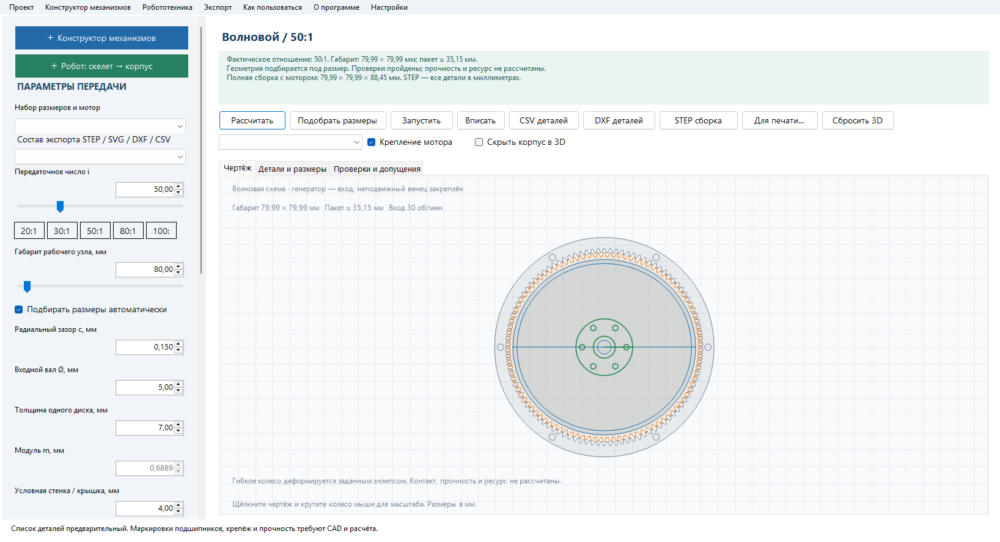

Скачайте **GearLab_5.6_Windows.zip**, полностью распакуйте и запустите **GearLab.exe**.

- Волновой теперь использует тот же MainForm, меню, числовые поля, ползунки, кнопки, вкладки и 3D-просмотрщик, что остальные редукторы. Отдельной формы и кнопки «Построить 3D» нет.
- Быстрый просмотр строится из параметрических профилей в памяти C#, без запуска Python/OCCT. Изменение момента и оборотов повторно использует готовую геометрию.
- На локальной машине готовая GPU-сцена 50:1 / 80:1 / 100:1 появилась за **0,55 / 0,17 / 0,20 с**. Старое нативное построение занимало около **48 с**. Это измерения конкретных стартовых компоновок на одной машине, не гарантия времени на любом ПК.
- Точный STEP рассчитывается при экспорте в фоне, с отменой и кэшем. Холодный полный экспорт может занимать около минуты; он больше не задерживает просмотр. Проверены 19 корректных тел полной сборки и 3 тела выбранного набора для печати.
- Старые `.wave.json` открываются в общем редакторе; сохранение — `.gear.json`. Схема, SVG/DXF/CSV, STL, робототехника и механизмы сохранены.

Пройдено 44 проверки общего интерфейса, быстрой сцены, анимации, переключения типов и миграции проекта; дополнительно выполнены проверки расчётов и экспорта. Отчёты: `docs/verification/5.6`. Проверки 5.4/5.5 хранятся отдельно как исторические.

Предпросмотр — параметрическая сетка, точный STEP — B-rep. Заданная деформация и компоновка не подтверждают контакт, упругость, прочность и ресурс. Контроллеры двигают экранную модель; физических моторов программа не подключает.

Бесплатная программа без открытой лицензии. Цифровой подписи Windows пока нет. Контрольные суммы и исходники приложены.
