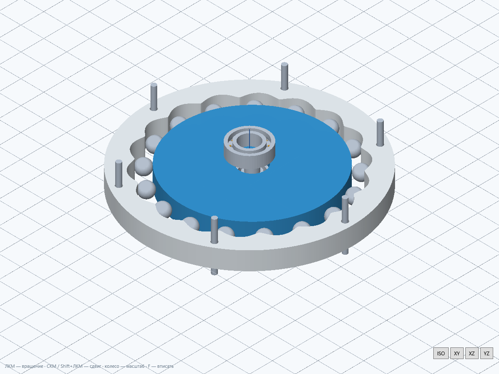

# GearLab 6.2

Волновая передача заменена ПТК по [видео TrashRobotics](https://www.youtube.com/watch?v=c73QGWpfhQw). По умолчанию: 17:1, 17 шариков Ø6 мм, 18 впадин, эксцентриситет 1,2 мм, радиус профиля 38 мм. Генератор — круглый эксцентрик, выход — сепаратор с радиальными окнами. Его фланец, перемычки и вал образуют одно связное тело для STEP и печати. Общий 2D-чертёж и анимация показывают эту же схему.

В опорах всех 13 типов и робота добавлены внутренние/наружные кольца с дорожками, шарики и корончатые сепараторы. Шарики в STEP — аналитические сферы, дорожки — тела вращения. В циклоидальном режиме число и диаметр шариков меняют 3D-подшипник диска.

«Ступени» переработаны: двигатель → карточки передач → выход. Компактные параметры применяются сразу; итоговые отношение, скорость и момент постоянно видны. Добавление вставляет ступень в цепь с переподключением следующей. Есть ↑ ↓, копирование, удаление, отмена/повтор и дополнительные ветвления. Исправлены размещение панелей и первоначальный показ 3D. «Свой механизм» убран из вкладок, меню, робототехники и команд запуска.

Старые проекты волнового редуктора переводятся в ПТК с сохранением передаточного числа и подбором подходящих геометрических размеров. Исходные файлы автоматически не переписываются. Для прежней гибкой схемы сохранён [релиз 6.1](https://github.com/mikko2281/GearLab/releases/tag/v6.1.0).

## Проверки

Локально: 6334 утверждения в проверках ПТК/подшипников, прежних исправлений, всех передач, цепей, робототехники и рабочего пространства. Быстрый ПТК 17/30/50: около 0,35/0,18/0,26 с без запуска CAD-ядра. Реальный интерфейс проверен в Windows.

Все 13 STEP повторно прочитаны OCCT: 1872 отдельных валидных тела с положительным объёмом. Числа по типам 0–12: 255 / 92 / 93 / 158 / 80 / 113 / 113 / 388 / 124 / 113 / 113 / 186 / 44. У подшипника отдельно проверены 63 потенциальных пары контакта: объёмных пересечений нет. Проверены ZIP/CRC, замкнутость рёбер и положительный объём фактических STL, включая цельный сепаратор. STEP/сетки соответствуют текущим параметрам; ошибочное редактирование не перезаписывает готовый экспорт.

[Отчёт и хеш локального EXE](verification/6.2/verification.json), [нативные результаты](verification/6.2/native62-results.json), [формулы и 133 хеша исходных файлов](ENGINEERING_6.2.json). Сервер GitHub повторяет проверки перед публикацией и собирает собственные архивы; его EXE и хеши архивов отличаются от локальных.

## Запуск и пределы

Распакуйте весь Windows ZIP. `Reducers.cmd` — редукторы, `Stages.cmd` — ступени, `Robotics.cmd` — робототехника. Программа бесплатная; доверенной цифровой подписи нет.

Подшипники являются детализированными параметрическими моделями, без каталожной грузоподъёмности. Не проверены прочность, ресурс, износ и контактные напряжения. Для остальных передач сохранены обозначенные в программе границы приближённых профилей; магнитному модулю нужен электромагнитный расчёт. Теоретический момент T·i·КПД не является допустимой нагрузкой. Публикация не означает производственную готовность.
