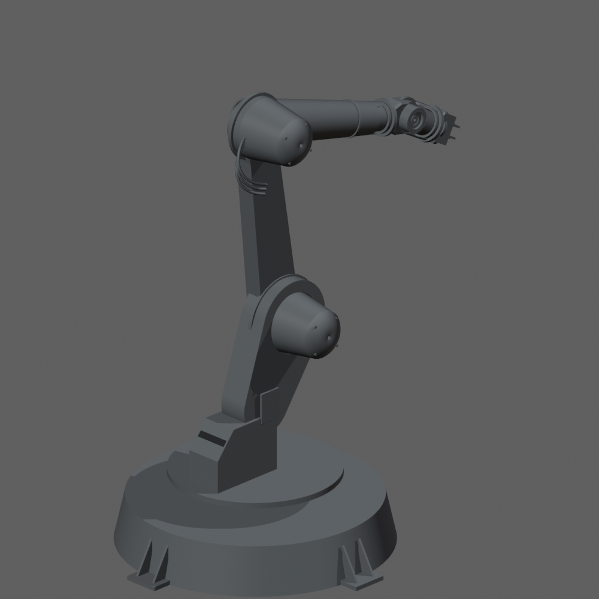

# Сравнение с визуальным примером

Откройте [сравнение рядом](СРАВНЕНИЕ.html). Слева — виды исходного игрового файла, справа — независимо построенная CAD-компоновка. Камеры одинакового направления; кадры отдельно вписаны по габаритам, поэтому сравнение не является измерением масштаба. Исходный .blend не изменён. Программный тест не может подтвердить субъективное визуальное сходство.

Сохранено направление формы: широкое низкое основание, наклонный нижний корпус, длинное плоское плечо и короткая кисть. Кожухи расширены у опор, торцевые крышки выпуклые. Реальные монтажные габариты NEMA17 ограничивают толщину суставов; механика не уменьшена ради картинки.

## Что ещё не готово

- Внутренние редукторы и дистанционная передача кисти: нет законченной силовой схемы, направляющих, натяжения и передаточных отношений.
- Крепления оболочек и моторных пластин, осевая фиксация валов и каталог крепежа требуют инженерной доработки. Подшипниковые тела — геометрические модели, не закупочная спецификация.
- Захват ещё не имеет законченного рассчитанного привода и направляющих.
- Проверено совпадение монтажных рамок в 24 позах, но не отсутствие пересечений во всём диапазоне движения. Даже раздельно валидные тела могут пересекаться в сборке.
- Крупные звенья и поворотный диск ещё не секционированы под P1S; автоматического допуска каждой детали к печати нет. Кабельные петли — компоновочные направляющие, не печатные детали.
- Требуются реальная характеристика момента двигателя, расчёт статических/динамических нагрузок, ползучести PETG, посадок, устойчивости основания и испытания. 300 г пока не подтверждены.
- Габариты трёх дистанционных NEMA17 заданы как 42,3×42,3×44 мм; альтернативные двигатели кисти пока требуют доработки их размещения в генераторе.

`ReadyForManufacture=false` у всех шести узлов. Геометрическая валидация и красивый вид не являются допуском машины к изготовлению.
